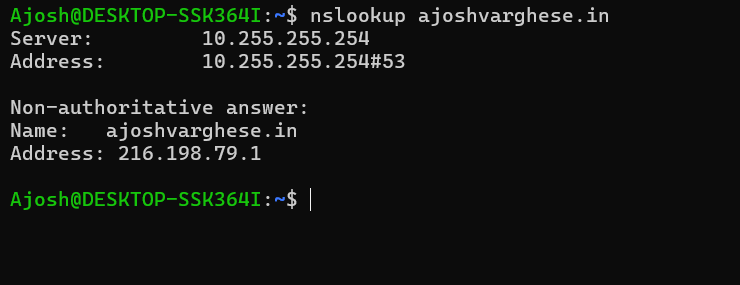
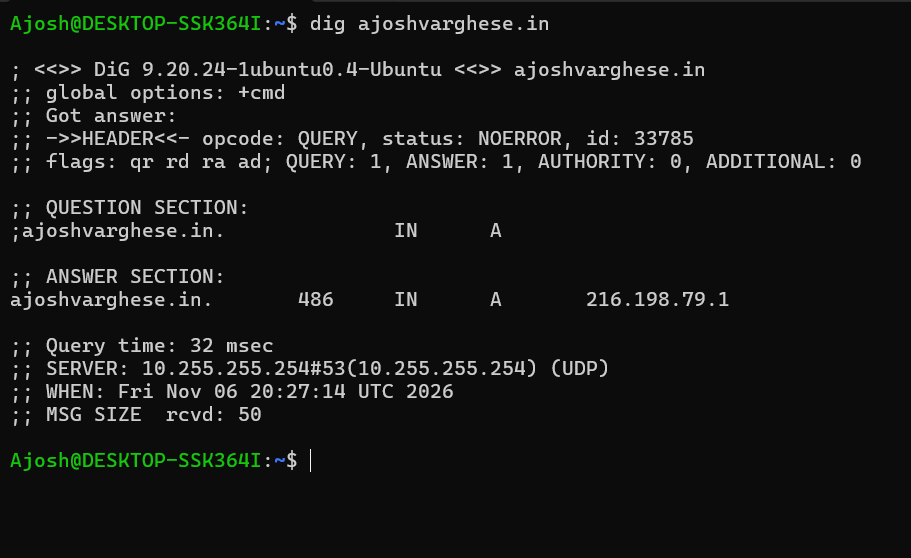
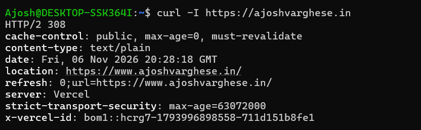
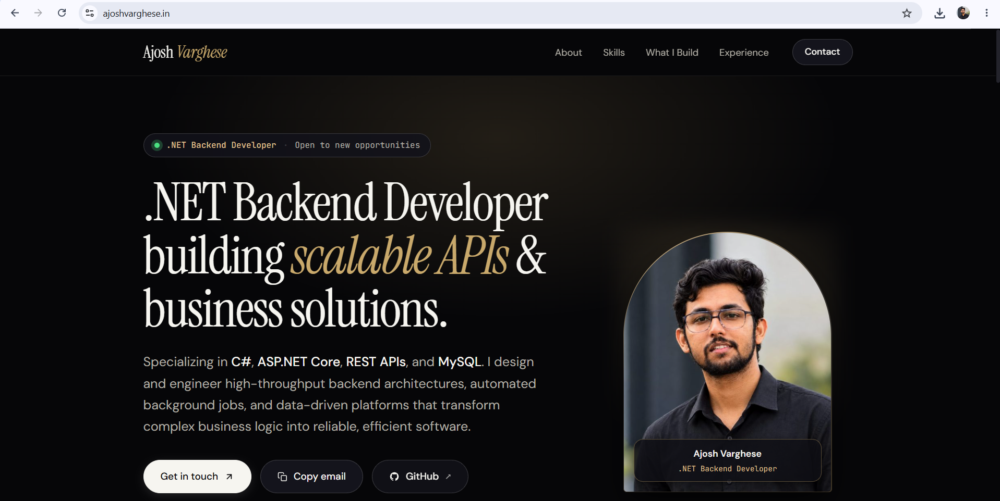
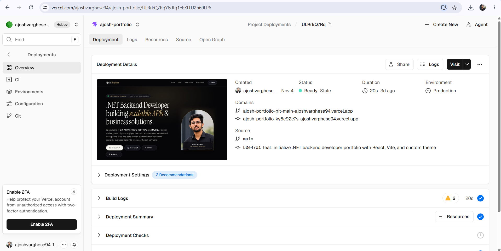
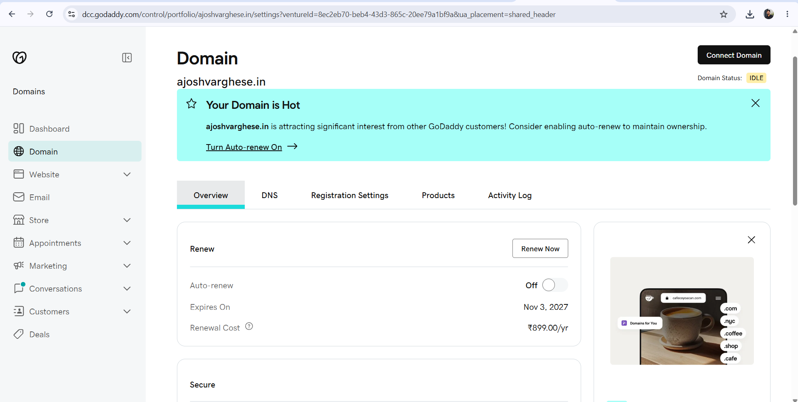
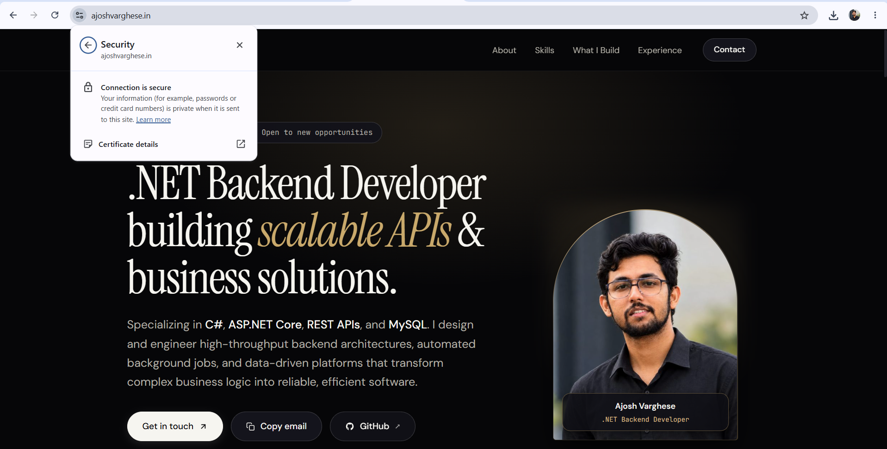
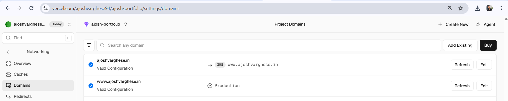

# Ajosh Varghese – Portfolio Website

DevOps & Networking Machine Test 03: DNS, HTTP, HTTPS and Custom Domain Deployment.

## Student and project details

| Item | Details |
|---|---|
| Student name | Ajosh Varghese |
| Batch | `<09:15 - 10:15 pm>` |
| Domain name | `ajoshvarghese.in` |
| Hosting platform | Vercel |
| Live website URL (Vercel) | https://ajosh-portfolio.vercel.app |
| Custom domain URL | https://ajoshvarghese.in |
| GitHub repository URL | https://github.com/ajoshvarghese94/MyPortfolio |
| Domain provider | GoDaddy |

## About the project

A responsive personal portfolio built with **React (Vite)**. Sections: **Home, About Me, Skills, Projects, Contact**. It is deployed on **Vercel** from the `main` branch and published on a custom `.in` domain with HTTPS.

## Run locally

```bash
npm install
npm run dev      # development
npm run build    # production build
```

## DNS configuration summary

| Type | Name | Value | Purpose |
|---|---|---|---|
| A | `@` | `216.198.79.1` | Root domain `ajoshvarghese.in` points to Vercel |
| CNAME | `www` | `cname.vercel-dns.com` | `www.ajoshvarghese.in` points to Vercel |
| NS | `@` | GoDaddy default nameservers (`ns..domaincontrol.com`) | Where the DNS records are hosted |

Vercel redirects the root domain to `www` (308 permanent redirect), so both addresses open the website. HTTPS certificates are issued and renewed automatically by Vercel.

## Task checklist

| # | Task | Status |
|---|---|---|
| 1 | Create the website (Home, About, Skills, Projects, Contact) | Done |
| 2 | Deploy on Vercel | Done |
| 3 | Purchase a custom domain (GoDaddy) | Done |
| 4 | Configure DNS (root and www) | `<tick when Vercel shows green ticks>` |
| 5 | Enable and verify HTTPS | `<tick after the padlock shows>` |
| 6 | DNS verification (nslookup, dig, curl) | `<paste outputs below>` |
| 7 | Request-flow diagram | Done: [docs/website-flow.md](docs/website-flow.md) |
| 8 | DNS concepts documentation | Done: [docs/dns-concepts.md](docs/dns-concepts.md) |

## Task 6: DNS verification

Replace each block with your real terminal output.

### nslookup
nslookup ajoshvarghese.in
**Screenshot:** 

### dig
dig ajoshvarghese.in
**Screenshot:** 

### curl
curl -I https://ajoshvarghese.in
**Screenshot:** 


**What to look for:** `nslookup` and `dig` should return the A record `216.198.79.1` (or the address Vercel shows). `curl -I` should return a `200` response, or a `308` redirect to `https://www.ajoshvarghese.in` followed by `200` there.

## Screenshots

| Required screenshot | File |
|---|---|
| Website running | `docs/screenshots/01-website-running.png` |
| Deployment dashboard | `docs/screenshots/02-deployment-dashboard.png` |
| Domain purchase details | `docs/screenshots/03-domain-purchase.png` |
| DNS records configuration | `docs/screenshots/04-dns-records.png` |
| HTTPS lock icon | `docs/screenshots/05-https-lock.png` |
| nslookup output | `docs/screenshots/06-nslookup.png` |
| dig output | `docs/screenshots/07-dig.png` |
| curl output | `docs/screenshots/08-curl.png` |
| DNS verification success (Vercel green ticks) | `docs/screenshots/09-dns-verification-success.png` |










## Documentation

- [Website request flow (Task 7)](docs/website-flow.md)
- [DNS, HTTP and HTTPS concepts (Task 8)](docs/dns-concepts.md)
