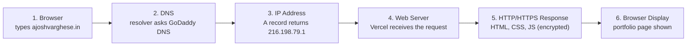
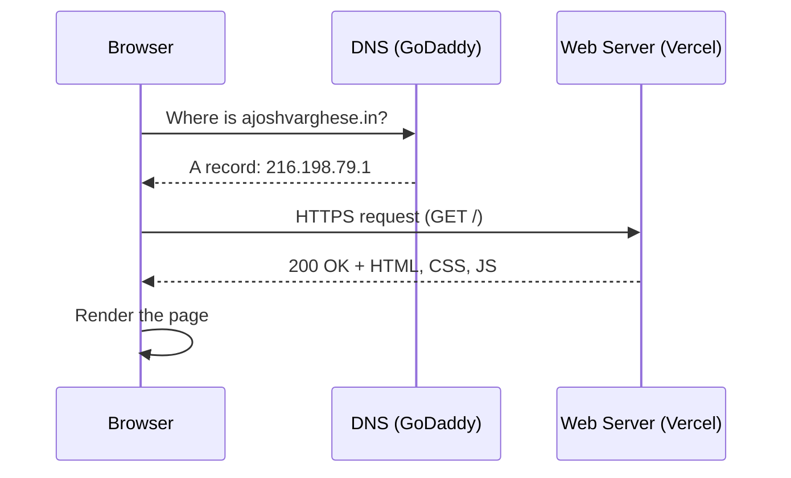

# Website Request Flow (Task 7)

What happens when someone opens `https://ajoshvarghese.in`.

## Diagram



Text version:

```
Browser --> DNS --> IP Address --> Web Server --> HTTP/HTTPS Response --> Browser Display
```

## Steps explained

1. **Browser:** the user types `ajoshvarghese.in`. The browser does not know where that is.
2. **DNS:** the browser asks a DNS resolver. The resolver finds the authoritative DNS servers for the domain (GoDaddy) and asks them.
3. **IP address:** the A record answers with the server's IP address, for example `216.198.79.1`.
4. **Web server:** the browser connects to that IP on port 443. A TLS handshake runs first, so the connection is encrypted. Vercel then decides which project to serve from the domain name.
5. **HTTP/HTTPS response:** the server sends back the page files (HTML, CSS, JavaScript, images) with status code `200 OK`. The root domain may first answer `308` and redirect to `www`.
6. **Browser display:** the browser builds the page and shows the portfolio with a padlock.

## Short sequence view


